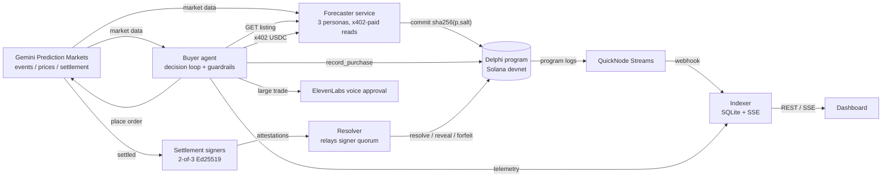

# Delphi — Architecture

Delphi is a forecast micro-market for AI agents. Forecasters sell probability
estimates on live Gemini Prediction Market contracts; buyer agents pay per read
in USDC on Solana via x402, pool what they bought, and trade on Gemini only when
they find edge. Gemini's settlement is the ground truth that scores every
forecast on-chain, so reputation is earned, not claimed.

## Components

| Path | Role |
| --- | --- |
| `programs/delphi` | Anchor program: forecaster registry, commit–reveal forecasts, purchases, market resolution, Brier scoring, forfeit, reputation. |
| `packages/shared` | Gemini client, pooling math, PDA helpers, `DelphiProgram` client, env loading. |
| `services/forecaster` | Express + `@x402/express`. Posts commitments on-chain, sells reveals per read. |
| `agents/buyer` | The agent. Scans, buys, pools, decides, gets approval, trades. |
| `services/resolver` | Relays settlement-signer attestations to resolve markets, reveals forecasts it holds, forfeits the rest an hour later, and sweeps bonds. |
| `scripts/attest.ts` | One settlement signer: reads Gemini itself and signs settled outcomes with its own key. |
| `scripts/publish-forecast.ts` | Third-party publishing: register, commit and upload a wallet-signed reveal without sharing a key. |
| `services/indexer` | QuickNode Streams webhook (or RPC poller) → SQLite → REST/SSE. |
| `apps/web` | Leaderboard, live feed, per-market view. |

## Forecaster personas

| Persona | Signal | Posts on |
| --- | --- | --- |
| `quant` | Driftless lognormal `P(spot ≥ strike)` from Gemini spot (`/v2/ticker`) and realized 1-minute vol (`/v2/candles`, last 240). Ignores the contract's market price. | Crypto contracts with a published strike (`above` ladders, and `reference` Up/Down once the reference price is set five minutes before expiry). Abstains elsewhere. |
| `momentum` | Market mid plus half the mid's change over the last 1–15 minutes, capped at ±5 points. | Every candidate. |
| `contrarian` | Market mid shrunk 20 % toward one half. | Every candidate. |

`quant` is the only persona carrying information the contract price does not
already encode; the other two are mid-derived baselines kept so scoring has
something to rank it against. Basis between the Lukka settlement index and
Gemini spot is accepted model error. Nothing is backtested; the rationale
sold with each read says so.

## Why commit–reveal

A forecast sold off-chain cannot be public on-chain or nobody would pay for it.
Each forecast is stored on-chain as `sha256(prob_bps ‖ salt)`. Buyers receive
`prob_bps` and `salt` in the paid payload. After the market resolves, *anyone*
holding the reveal can call `reveal_and_score` once the market resolves. One
hour later, anyone can call `forfeit_forecast` on a commitment that is still
unrevealed; it scores Brier 10000, the worst score. Forecasters cannot hide a
bad call by staying silent, and buyers can force the true score of what they
paid for before that window closes.

The resolver uses the recent-settlement feed as a fast path, then looks up the
exact event for each unmatched on-chain market. An outage longer than the
feed's coverage must not strand an older market. Direct lookups are grouped by
event ticker; only an exact contract match with a settled/resolved status and
a Yes/No outcome can resolve it. Forfeiture uses the Solana chain clock.
A reveal that wins a race with forfeiture is already terminal, not a retry
failure.

## On-chain state

| Account | Seeds | Purpose |
| --- | --- | --- |
| `Config` | `["config"]` | Bootstrap authority that initializes the settlement and bond configs once. It cannot resolve markets. |
| `SettlementConfig` | `["settlement_config"]` | Immutable 2–5 signer set and threshold (≥ 2). |
| `Forecaster` | `["forecaster", authority]` | Name, price per read, reads, Brier sum, `reputation_bps`. |
| `Market` | `["market", sha256(instrument_symbol)]` | Gemini instrument, resolution outcome. |
| `Forecast` | `["forecast", forecaster, market_hash]` | Commitment, reads, revealed probability, forfeit flag, Brier. |
| `Purchase` | `["purchase", forecast, buyer]` | Amount, x402 settlement signature. |
| `BondConfig` | `["bond_config"]` | Immutable bond mint and slash treasury token account. |
| `ForecastBond` / vault | `["forecast_bond", forecast]` / `["bond_vault", forecast]` | Escrowed USDC, depositor's refund account, settled/slashed flags. |

`resolve_market` reads the instructions sysvar and counts preceding Ed25519
precompile instructions whose key, signature and 32-byte message all lie inside
that instruction, whose key is in the signer set, and whose message is
`sha256("delphi:settlement:v1" ‖ program ‖ settlement_config ‖ market ‖ outcome)`.
Duplicates and outsiders are rejected; fewer than `threshold` distinct signers
fail. A bond settles once, only after its forecast is revealed (refund to the
depositor's recorded account) or forfeited (slash to the treasury).

Scoring: `brier_bps = (prob_bps - outcome*10000)^2 / 10000`. Reputation uses
integer division and shrinks toward a 5000 Brier prior of weight 5:
`reputation_bps = 10000 - (brier_sum_bps + 5*5000) / (scored_count + 5)`
(5000 before any score). A forfeit adds 10000 to the Brier sum.

## Buyer agent decision loop

Each tick (30 s):

1. **scan** — list active binary Gemini contracts expiring in [2 min, 24 h] with a
   bid or ask.
2. **buy** — fetch the free listing for the symbol, keep forecasters with
   `reputation_bps ≥ BUYER_MIN_FORECASTER_REPUTATION_BPS` and
   `price ≤ BUYER_MAX_READ_PRICE_USDC`, sorted by reputation, until the
   per-market read budget is exhausted. Each read is an x402 `exact` payment in
   devnet USDC; the settlement signature is recorded on-chain with
   `record_purchase`.
3. **aggregate** — reputation-weighted log-odds pooling of purchased forecasts.
4. **decide** — refresh the candidate's exact parent event, regardless of its
   catalog page. Compare pooled probability with the executable Yes ask or
   No ask derived from the Yes bid, including fees; require
   `edge ≥ BUYER_EDGE_THRESHOLD`. Size with capped fractional Kelly, bounded by
   per-market budget, `BUYER_MAX_POSITION_USDC`, and remaining daily budget.
   Contract expiry falls back to the parent event's expiry and is checked both
   before sizing and after authorization.
5. **approve** — tiered: `< BUYER_AUTO_APPROVE_BELOW_USDC` auto;
   `< BUYER_VOICE_APPROVE_ABOVE_USDC` notify and proceed; otherwise an ElevenLabs
   voice agent calls the approver and the trade proceeds only on an explicit
   spoken "yes" (terminal prompt fallback when voice is not configured; timeout
   is a denial).
6. **trade** — Gemini limit IOC order. `BUYER_DRY_RUN=true` skips payments and trades.
7. **reveal** — once a purchased market resolves, call `reveal_and_score` for
   each purchased forecast. A forecast already forfeited is terminal; the buyer
   stops retrying it.

Every stage emits telemetry to the indexer. Full limits and the kill switch are
in [guardrails.md](./guardrails.md).

## Data flow for reputation

Program events (`ForecastPosted`, `PurchaseRecorded`, `MarketResolved`,
`ForecastScored`) are emitted as Anchor logs. QuickNode Streams filters devnet
transactions touching the program and USDC transfers to forecaster accounts and
pushes them to the indexer webhook in order. Configuration is in
[streams.md](./streams.md). `INDEXER_SOURCE=rpc` polls the RPC instead for
environments without a QuickNode account.

## Trust assumptions (hackathon scope)

- Settlement needs `threshold` of the configured signers to agree. Each signer
  reads Gemini independently; a single compromised key, or the resolver host,
  cannot resolve a market. The signer set is immutable once initialized.
- `record_purchase` is signed by the buyer and carries the x402 settlement
  signature; the indexer cross-checks USDC transfers. Nothing stops a buyer from
  recording a purchase it did not pay for, but it gains nothing by doing so —
  reads only affect leaderboard volume, not reputation.
- Forecast quality is scored on every resolved forecast that was posted.
  Reveals use the committed probability; anything still unrevealed an hour
  later is forfeited at the worst Brier. A forecaster that never posts on a
  market is not scored on it. Buyers can reveal anything they bought before
  the window closes.
