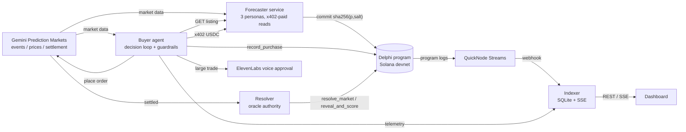

# Delphi — Architecture

Delphi is a forecast micro-market for AI agents. Forecasters sell probability
estimates on live Gemini Prediction Market contracts; buyer agents pay per read
in USDC on Solana via x402, pool what they bought, and trade on Gemini only when
they find edge. Gemini's settlement is the ground truth that scores every
forecast on-chain, so reputation is earned, not claimed.

## Components

| Path | Role |
| --- | --- |
| `programs/delphi` | Anchor program: forecaster registry, commit–reveal forecasts, purchases, market resolution, Brier scoring, reputation. |
| `packages/shared` | Gemini client, pooling math, PDA helpers, `DelphiProgram` client, env loading. |
| `services/forecaster` | Express + `@x402/express`. Posts commitments on-chain, sells reveals per read. |
| `agents/buyer` | The agent. Scans, buys, pools, decides, gets approval, trades. |
| `services/resolver` | Reads Gemini settlements, resolves markets, reveals and scores forecasts. |
| `services/indexer` | QuickNode Streams webhook (or RPC poller) → SQLite → REST/SSE. |
| `apps/web` | Leaderboard, live feed, per-market view. |

## Forecaster personas

| Persona | Signal | Posts on |
| --- | --- | --- |
| `quant` | Driftless lognormal `P(spot ≥ strike)` from Gemini spot (`/v2/ticker`) and realized 1-minute vol (`/v2/candles`, last 240). Ignores the contract's market price. | Crypto contracts with a published strike (`above` ladders, and `reference` Up/Down once the reference price is set five minutes before expiry). Abstains elsewhere. |
| `momentum` | Market mid plus half the mid's change over the last 1–15 minutes, capped at ±5 points. | Every candidate. |
| `contrarian` | Market mid shrunk 20 % toward one half. | Every candidate. |

`quant` is the only persona carrying information the contract price does not
already encode; the other two are mid-derived baselines kept so scoring has
something to rank it against. Basis between the Lukka settlement index and
Gemini spot is accepted model error. Nothing is backtested; the rationale
sold with each read says so.

## Why commit–reveal

A forecast sold off-chain cannot be public on-chain or nobody would pay for it.
Each forecast is stored on-chain as `sha256(prob_bps ‖ salt)`. Buyers receive
`prob_bps` and `salt` in the paid payload. After the market resolves, *anyone*
holding the reveal can call `reveal_and_score`. Forecasters cannot hide bad
calls; buyers can force scoring of what they paid for.

## On-chain state

| Account | Seeds | Purpose |
| --- | --- | --- |
| `Config` | `["config"]` | Oracle authority allowed to resolve markets. |
| `Forecaster` | `["forecaster", authority]` | Name, price per read, reads, Brier sum, `reputation_bps`. |
| `Market` | `["market", sha256(instrument_symbol)]` | Gemini instrument, resolution outcome. |
| `Forecast` | `["forecast", forecaster, market_hash]` | Commitment, reads, revealed prob, Brier. |
| `Purchase` | `["purchase", forecast, buyer]` | Amount, x402 settlement signature. |

Scoring: `brier_bps = (prob_bps - outcome*10000)^2 / 10000`,
`reputation_bps = 10000 - brier_sum_bps / scored_count` (5000 before any score).

## Buyer agent decision loop

Each tick (30 s):

1. **scan** — list active binary Gemini contracts expiring in [2 min, 24 h] with a
   quotable mid price.
2. **buy** — fetch the free listing for the symbol, keep forecasters with
   `reputation_bps ≥ BUYER_MIN_FORECASTER_REPUTATION_BPS` and
   `price ≤ BUYER_MAX_READ_PRICE_USDC`, sorted by reputation, until the
   per-market read budget is exhausted. Each read is an x402 `exact` payment in
   devnet USDC; the settlement signature is recorded on-chain with
   `record_purchase`.
3. **aggregate** — reputation-weighted log-odds pooling of purchased forecasts.
4. **decide** — compare pooled probability to the Gemini mid. Skip unless
   `|edge| ≥ BUYER_EDGE_THRESHOLD`. Size with capped fractional Kelly, bounded by
   per-market budget, `BUYER_MAX_POSITION_USDC`, and remaining daily budget.
5. **approve** — tiered: `< BUYER_AUTO_APPROVE_BELOW_USDC` auto;
   `< BUYER_VOICE_APPROVE_ABOVE_USDC` notify and proceed; otherwise an ElevenLabs
   voice agent calls the approver and the trade proceeds only on an explicit
   spoken "yes" (terminal prompt fallback when voice is not configured; timeout
   is a denial).
6. **trade** — Gemini limit IOC order (`BUYER_DRY_RUN=true` logs instead).
7. **reveal** — once a purchased market resolves, call `reveal_and_score` for
   each purchased forecast so forecasters are scored even if they go quiet.

Every stage emits telemetry to the indexer. Full limits and the kill switch are
in [guardrails.md](./guardrails.md).

## Data flow for reputation

Program events (`ForecastPosted`, `PurchaseRecorded`, `MarketResolved`,
`ForecastScored`) are emitted as Anchor logs. QuickNode Streams filters devnet
transactions touching the program and USDC transfers to forecaster accounts and
pushes them to the indexer webhook in order. Configuration is in
[streams.md](./streams.md). `INDEXER_SOURCE=rpc` polls the RPC instead for
environments without a QuickNode account.

## Trust assumptions (hackathon scope)

- The resolver holds the oracle key and mirrors Gemini's `resolutionSide`.
  Production would use a multisig or an attestation of Gemini's settlement.
- `record_purchase` is signed by the buyer and carries the x402 settlement
  signature; the indexer cross-checks USDC transfers. Nothing stops a buyer from
  recording a purchase it did not pay for, but it gains nothing by doing so —
  reads only affect leaderboard volume, not reputation.
- Forecast quality is scored only on revealed forecasts; a forecaster that sells
  nothing on a market is never scored on it. Buyers can reveal anything they
  bought.
